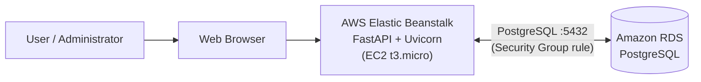

<div align="center">

# 🧪 Laboratory Equipment Inventory Management System

*Gestion de l'inventaire du matériel d'un laboratoire*

A cloud-based web application to track, update and manage laboratory equipment,
deployed on **Amazon Web Services (AWS)**.


*Cloud Computing Mini Project · Team of 5*

</div>

---

## 📑 Table of Contents

1. [Overview](#-overview)
2. [Features](#-features)
3. [Technologies Used](#-technologies-used)
4. [Architecture](#-architecture)
5. [AWS Resources](#-aws-resources)
6. [Database](#-database)
7. [Repository Structure](#-repository-structure)
8. [Configuration](#-configuration)
9. [Run Locally](#-run-locally)
10. [Deployment](#-deployment)
11. [Persistence Demonstration](#-persistence-demonstration)
12. [Security](#-security)
13. [Git Workflow](#-git-workflow)
14. [Team](#-team)
15. [Clean-up](#-clean-up)

---

## 🔎 Overview

Laboratories hold many kinds of equipment: computers, monitors, printers, projectors and technical devices. Tracking them by hand leads to lost information, unknown equipment conditions and no central access to the inventory.

This project provides a web application that lets laboratory administrators manage the whole inventory from one place.

> **Key goal: data persistence after redeployment.**
> The application (AWS Elastic Beanstalk) and the data (Amazon RDS) are separate cloud resources. Redeploying the code never deletes the inventory stored in the database.

## ✨ Features

- 📋 View all laboratory equipment
- ➕ Add new equipment
- ✏️ Edit equipment information
- 🔄 Change equipment status: `Available`, `In Use`, `Under Maintenance`, `Out of Service`
- 🗑️ Delete equipment
- 📊 Dashboard with inventory statistics
- 🔍 Search by name, filter by category and status
- 💾 Persistent storage in a managed cloud database

## 🛠️ Technologies Used

| Layer | Technology | Purpose |
|---|---|---|
| **Frontend** | HTML, CSS, Bootstrap | Responsive user interface |
| **Backend** | Python, FastAPI, Uvicorn | REST API and application logic |
| **ORM** | SQLAlchemy | Database access (parameterized queries) |
| **Database** | PostgreSQL on Amazon RDS | Persistent, managed relational storage |
| **Hosting** | AWS Elastic Beanstalk (EC2 `t3.micro`) | Managed application deployment |
| **Networking** | VPC, Security Groups | Controlled access between app and database |
| **Security & Access** | AWS IAM, MFA | Least-privilege access, protected root account |
| **Cost control** | AWS Budgets, Free Tier credits | Spending alerts |
| **Version control** | Git and GitHub | Source code management |

## 🏗️ Architecture

Three-layer architecture on AWS (PaaS model):



| Layer | Role | Service |
|---|---|---|
| Presentation | Web interface | Browser, HTML/CSS/Bootstrap |
| Application | Business logic and API | Elastic Beanstalk (FastAPI) |
| Data | Persistent storage | Amazon RDS (PostgreSQL) |

**How it works:** the browser sends requests to the backend, the backend validates them and talks to RDS through a security-group-protected connection, and the results are returned to the interface.

## ☁️ AWS Resources

| Resource | Name / Value |
|---|---|
| Region | Europe (Paris) `eu-west-3` |
| RDS instance | `lab-inventory-db` (PostgreSQL, `db.t3.micro`, 20 GiB gp3, Single-AZ) |
| Database name | `laboratoryinventory` |
| Database security group | `lab-inventory-db-sg` (port 5432) |
| Elastic Beanstalk application | `lab-inventory-app` (Python platform, `t3.micro`) |
| Resource tag (all resources) | `Project = LabInventory` |
| Budget | Zero-spend budget alert |

Names may change during deployment.

## 🗄️ Database

- Main table: `Equipment`
- Allowed `Status` values (enforced by a `CHECK` constraint): `Available`, `In Use`, `Under Maintenance`, `Out of Service`

| Column | Type (PostgreSQL) | Description |
|---|---|---|
| `Id` | `SERIAL` (primary key) | Identifier |
| `Name` | `VARCHAR(100)` | Equipment name |
| `Category` | `VARCHAR(50)` | Equipment category |
| `Description` | `VARCHAR(255)` | Equipment description |
| `SerialNumber` | `VARCHAR(100)` unique | Serial number |
| `Status` | `VARCHAR(30)` | Current status |
| `Location` | `VARCHAR(100)` | Laboratory location |
| `PurchaseDate` | `DATE` | Purchase date |
| `CreatedAt` | `TIMESTAMP` | Creation date |

SQL scripts are in the `database/` folder.

## 📁 Repository Structure

```
lab-inventory-system/
├── backend/      # FastAPI source code
├── frontend/     # User interface
├── database/     # SQL scripts (schema, sample data)
├── infra/        # AWS configuration notes and screenshots
├── docs/         # Project documentation, test reports
├── .env.example  # Template for environment variables
└── README.md
```

## ⚙️ Configuration

Credentials are **never** committed to this repository.

- **Locally:** copy `.env.example` to `.env` and fill in your values (`.env` is git-ignored).
- **On AWS:** set the same variables as **Environment properties** in the Elastic Beanstalk environment (Configuration, Updates/monitoring/logging).

| Variable | Description |
|---|---|
| `DB_HOST` | RDS endpoint |
| `DB_PORT` | Database port (`5432`) |
| `DB_NAME` | Database name |
| `DB_USER` | Database master username |
| `DB_PASSWORD` | Database password |

## 💻 Run Locally

```bash
# 1. Clone
git clone https://github.com/<owner>/lab-inventory-system.git
cd lab-inventory-system

# 2. Configure environment
cp .env.example .env          # Windows PowerShell: Copy-Item .env.example .env

# 3. Install dependencies and start the API
cd backend
python -m venv venv
source venv/bin/activate      # Windows PowerShell: venv\Scripts\Activate.ps1
pip install -r requirements.txt
uvicorn main:app --reload
```

The API runs on `http://127.0.0.1:8000` (interactive docs at `/docs`).

## 🚀 Deployment

1. Create the AWS resources (see [`infra/`](infra/)): RDS instance, security groups, Elastic Beanstalk application.
2. Make sure the RDS security group allows port 5432 from the application's security group.
3. Add `requirements.txt` and a `Procfile` to the backend, for example:
   ```
   web: uvicorn main:app --host 0.0.0.0 --port 8000
   ```
4. Set the environment properties (`DB_HOST`, `DB_PORT`, `DB_NAME`, `DB_USER`, `DB_PASSWORD`) in Elastic Beanstalk.
5. Deploy the application (zip upload in the console, or the `eb` CLI).
6. Open the public Elastic Beanstalk URL and verify the database connection.

## 🔁 Persistence Demonstration

1. Deploy the application.
2. Add three items (Dell Computer, HP Monitor, Epson Projector).
3. Set the Dell Computer to `Under Maintenance`.
4. Change a small element (e.g. the dashboard title) and **redeploy**.
5. Reopen the app: all records and statuses are still there.

**Why it works:** Elastic Beanstalk and RDS are independent resources. A new deployment replaces the application code only, and the RDS database is not touched.

## 🔒 Security

- No credentials in the repository; secrets live in environment properties
- Root account protected with MFA; daily work done with an IAM user
- Database reachable only through security group rules (never open to `0.0.0.0/0`)
- Parameterized queries through the ORM, input validation on all forms
- Unique serial numbers enforced by the database
- Budget alert to detect unexpected spending
- HTTPS: planned (the default Elastic Beanstalk URL is HTTP; HTTPS needs a certificate and a load balancer)

## 🌿 Git Workflow

- `main`: stable, deployed code
- `dev`: integration branch
- `feature/<name>`: one branch per task, merged into `dev` through a Pull Request

## 👥 Team

| Member | Role | Responsibility |
|---|---|---|
| **Houcine** | Cloud Infrastructure Engineer | AWS resources, networking, environment properties |
| **Fatima** | Database Developer | Schema, SQL scripts, sample data |
| **Mohammed** | Backend Developer | API, CRUD, database integration |
| **Aya** | Frontend Developer | Dashboard, forms, responsive UI |
| **Abdo** | Integration, Testing and Documentation | Repository, integration, tests, presentation |

## 🧹 Clean-up

AWS resources keep using credits while they run. When the project is finished, delete the Elastic Beanstalk environment and the RDS instance (take a final snapshot if the data must be kept).

## 📄 License

Academic project, for educational purposes.
