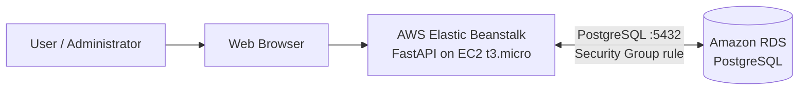

# ☁️ AWS Infrastructure: Lab Inventory Project

**Member 1: Cloud Infrastructure Engineer (Houcine)**
Cloud Computing Mini Project · Laboratory Equipment Inventory Management System

> 🎯 **Goal of my part:** build the cloud infrastructure so the application and its data live in **separate managed services**, and redeploying the app never deletes the data.

---

## 1. Why AWS instead of Azure?

- Our plan was Azure (App Service + Azure SQL).
- My **Azure for Students** verification kept failing with *"You do not have access"*, a block on Microsoft's side that I could not fix myself.
- I switched to the **AWS Free plan**, which gives new customers credits to use for a limited time.
- **The cloud concepts stay identical:** PaaS, managed database, separation of app and data, persistence after redeployment.

> ⚠️ **Note for the team:** the project PDF is written around Azure. We should confirm with the professor that AWS is accepted.

---

## 2. Architecture

| Azure (original plan) | AWS (what I built) |
|---|---|
| Resource Group | Region (Paris) + tag `Project = LabInventory` |
| Azure SQL Database | **Amazon RDS** (PostgreSQL) |
| Azure App Service (F1) | **AWS Elastic Beanstalk** (Python) |
| SQL Server firewall rules | **Security Groups** |
| App Service environment variables | Elastic Beanstalk **environment properties** |
| Budget / Free plan limits | **AWS Budgets** + Free plan credits |

---

## 3. Step 1: Secure the account

What I did:
1. Enabled **MFA** (authenticator app) on the root user.
2. Created an **IAM admin user** and stopped using the root account for daily work.
3. Created a **zero-spend budget alert**.

**Why:** the root account can do everything, including spending credits, so it must be protected and rarely used.

---

## 4. Step 2: Region and tagging

- Region: **Europe (Paris) `eu-west-3`**, used for every resource.
- Every resource is tagged **`Project = LabInventory`**, our equivalent of an Azure Resource Group.

---

## 5. Step 3: Database (Amazon RDS)

| Setting | Value |
|---|---|
| Engine | PostgreSQL |
| Identifier | `lab-inventory-db` |
| Instance class | `db.t3.micro` |
| Storage | 20 GiB gp3 |
| Availability | Single-AZ |
| Initial database | `laboratoryinventory` |
| Tag | `Project = LabInventory` |

**Why PostgreSQL:** simple to use from FastAPI. Fatima adapts the SQL script (`SERIAL`, `VARCHAR`, `NOW()` instead of `IDENTITY`, `NVARCHAR`, `GETDATE()`).

---

## 6. Step 4: Firewall (Security Groups)

**Database security group `lab-inventory-db-sg`:**

| Rule | Port | Source |
|---|---|---|
| PostgreSQL | 5432 | My IP only (for testing and loading the schema) |
| PostgreSQL | 5432 | The Elastic Beanstalk app's security group |

- The database is **not open to the internet**: only my machine and the app server can connect.
- Using the app's *security group* as the source (instead of an IP) keeps working even if the server's IP changes.
- Teammates who need to test from their laptops give me their IP, and I add one rule per person.

---

## 7. Step 5: Application hosting (Elastic Beanstalk)

| Setting | Value |
|---|---|
| Application | `lab-inventory-app` |
| Environment | single instance (no load balancer, to save credits) |
| Platform | Python on Amazon Linux 2023 |
| Instance type | `t3.micro` |
| Database | **not** created inside Beanstalk |

**Why not create the database inside Beanstalk:** it would be deleted together with the environment, which would break our persistence requirement.

---

## 8. Step 6: Configuration without secrets in GitHub

Database settings are **environment properties** in Elastic Beanstalk, never in the repository:

| Name | Purpose |
|---|---|
| `DB_HOST` | RDS endpoint |
| `DB_PORT` | `5432` |
| `DB_NAME` | `laboratoryinventory` |
| `DB_USER` | database username |
| `DB_PASSWORD` | database password |

The repository only contains `.env.example` with placeholder values.

---

## 9. Step 7: Connectivity test ✅

I deployed a tiny FastAPI test app with a `/db-check` page. It reads the environment properties, connects to RDS, and reports the result.

**Result:** `status: ok`, *Connected to Amazon RDS PostgreSQL*, database `laboratoryinventory`.

This proves the chain **Browser → Elastic Beanstalk → RDS** works through the security group rules.

---

## 10. Problems we hit and how we solved them

| Problem | Cause | Fix |
|---|---|---|
| Azure: *"You do not have access"* | Student verification blocked on Microsoft's side | Switched to AWS |
| MFA: *"Signature expired"* | My computer's clock was off by about 45 minutes | Enabled automatic time sync |
| Region list showed locks | I was on a global page (Billing), not a regional one | Opened RDS, then picked Paris |
| RDS estimate showed about $18/month | The wizard shows the standard price, not the Free plan credits | Checked the plan and credits before creating |
| Security group name rejected | Names can't start with `sg-` (reserved prefix) | Renamed it `lab-inventory-db-sg` |
| App rule added to the wrong group | Edited the app's group instead of the database's | Cancelled, then added the rule to `lab-inventory-db-sg` |

---

## 11. What the rest of the team needs

| Who | What they need from the infrastructure |
|---|---|
| **Fatima (Database)** | PostgreSQL syntax for the schema; send me your IP to be allowed |
| **Mohammed (Backend)** | Read `DB_HOST`, `DB_PORT`, `DB_NAME`, `DB_USER`, `DB_PASSWORD` from the environment; add `requirements.txt` and a `Procfile`; deploy as a zip |
| **Aya (Frontend)** | Public URL of the environment once the real app is deployed |
| **Abdo (Integration)** | Redeployment persistence demo; screenshots and documentation |

---

## 12. Cost control and clean-up

- Budget alert is active; the Free plan draws on credits and closes after a limited time.
- RDS and the EC2 instance keep using credits while running.
- **After the project:** delete the Elastic Beanstalk environment and the RDS instance (take a final snapshot if the data must be kept).

---

## 13. Status

- ✅ Account secured (MFA, IAM user, budget alert)
- ✅ Region and tags
- ✅ RDS PostgreSQL created
- ✅ Security groups configured
- ✅ Elastic Beanstalk environment running
- ✅ Environment properties set
- ✅ Connectivity verified
- ⬜ Change the database password (it was exposed while testing)
- ⬜ Open HTTP port 80 for the demo, then close it again
- ⬜ Deploy the real FastAPI application
- ⬜ Redeployment persistence demonstration

---

## 14. Questions the professor might ask

| Question | Short answer |
|---|---|
| Why Elastic Beanstalk? | Managed (PaaS) hosting: we give it code, AWS manages servers, web server and deployment |
| Why RDS? | Managed relational database: backups, patching and storage are handled by AWS |
| Why separate the app and the database? | Redeploying the app replaces only the code; the data stays in RDS |
| What is a security group? | A virtual firewall that controls which traffic can reach a resource |
| Why not open the database to everyone? | Least privilege: only the app server and authorized IPs may connect |
| What is PaaS vs IaaS? | PaaS gives a managed platform for apps; IaaS gives raw infrastructure like virtual machines |
| What happens if the database is unavailable? | Database operations fail and the application must handle the error |
